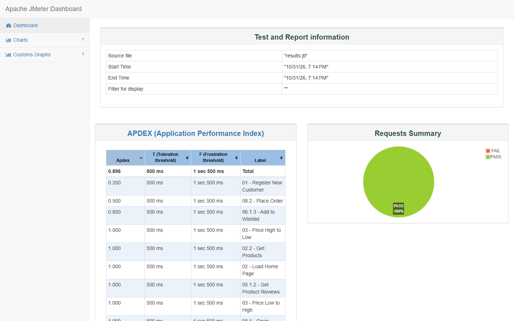
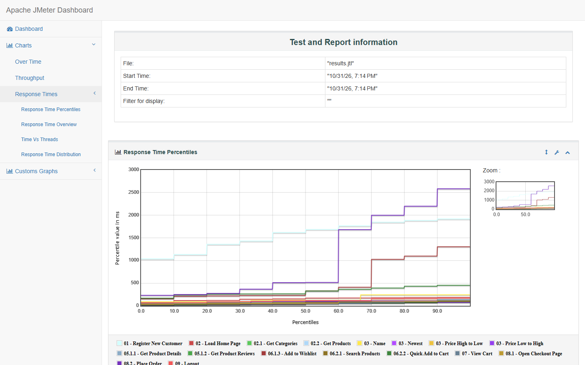

<h1 align="center">EduShop JMeter Performance Test</h1>
<p align="center"><strong>The New Customer Journey</strong></p>
<p align="center">10 virtual customers · 4 random sort options · 2 shopping paths · 10 completed orders</p>
<p align="center">
  
  
  
  
</p>
<p align="center">A data-driven load test for the EduShop API: new customers register, browse, shop, place a first order, and log out.</p>
<p align="center">
  <a href="NewCustomer.jmx">Explore the test plan</a> ·
  <a href="customers.csv">View the test data</a> ·
  <a href="figures/jmeter-dashboard.png">See the JMeter dashboard</a>
</p>

## Project at a glance

- **Workload:** 10 users, 10-second ramp-up, one iteration each.
- **Coverage:** registration, homepage, category browse, product details, reviews, wishlist, search, cart, checkout, and logout.
- **Verified result:** 10 orders created, 0 failed samples in the final local run.
- **Target:** the EduShop API at `http://localhost:5000`.

## Testing approach

## Files in this folder

- `NewCustomer.jmx` — the runnable test plan.
- `customers.csv` — ten customer rows. The email prefix is combined with the current time and thread number, so every registration uses a new email.
- `figures/jmeter-dashboard.png` and `figures/jmeter-response-times.png` — screenshots from the generated Apache JMeter HTML report.

Raw JMeter results (`results.jtl`) and the generated HTML dashboard (`report/`) are kept out of Git. Generate them locally when you run the plan. The assignment submission ZIP, which includes these files, is separate from this GitHub folder.

## User journey

1. Register with a unique email and extract `$.accessToken`.
2. Continue only when the token is present. Protected requests send `Authorization: Bearer ${accessToken}`.
3. Load categories and the first twelve products in a Transaction Controller to measure home page load.
4. Browse the CSV category with one randomly selected sort: price ascending, price descending, newest, or name. Extract a random product ID from `$.items[*].id`.
5. Run both shopping paths in random order:
   - Open the selected product and its reviews, then add it to the wishlist.
   - Search with the CSV term, select an in-stock result, and quick-add quantity 1 to the cart.
6. Open the cart and checkout page. If `$.totalItems > 0`, place the order using the CSV shipping address and payment method.
7. Log out.

The plan uses a Thread Group (10 threads, 10-second ramp-up, one iteration), HTTP Request Defaults, two Header Managers, CSV Data Set Config, JSON Extractors, If Controllers, a Transaction Controller, Random Controller, Random Order Controller, Loop Controller, Uniform Random Timer, BeanShell PreProcessor, assertions, and listeners. A Debug Sampler is included but disabled for the measured run; enable it while troubleshooting variables.

## Run locally

1. Start the EduShop backend separately from its [source repository](https://github.com/BayanAlhassoun/E-Commerce-test-project-for-API---JMeter---Automation) with `docker compose up -d --build`. Confirm `http://localhost:5000/api/category` responds.
2. **Replenish stock before each load run.** Sign in as an Admin using `POST /api/auth/login`. For products in the categories used by `customers.csv`, read their current values from `GET /api/product?Page=1&PageSize=500`, then send `PUT /api/product/{id}` with the Admin bearer token. The update requires the full product body: `name`, `description`, `price`, `stock`, `imageUrl`, `categoryId`, `discountPercentage`, and `isActive`. Preserve the other fields and set `stock` high enough for the run (100 was used for verification). Confirm the returned stock. The seeded Admin credentials are documented in the EduShop source repository's README.
3. Check that every CSV `category` appears in `GET /api/category`. This matters if the database has been changed since seeding. CSV addresses contain commas, so the JMeter CSV Data Set uses **Allow quoted data = true**.
4. Run JMeter 5.6.3 from this folder. Use a new output directory for each run:

   ```powershell
   New-Item -ItemType Directory run-20261031
   jmeter -n -t NewCustomer.jmx -l run-20261031/results.jtl -e -o run-20261031/report
   ```

   Replace `run-20261031` with a fresh directory name. The report destination must not already contain files. If `jmeter` is not on `PATH`, invoke `jmeter.bat` from your JMeter `bin` directory.
5. Open `run-20261031/report/index.html`. Check response codes and assertion failures in `results.jtl` if the dashboard reports errors.

## Verified local run

On **31 October 2026 at 19:14 (Asia/Amman)**, the plan was run against a local EduShop instance with ten users and one iteration. The JTL recorded **140 entries with zero failures**; ten registrations returned HTTP 200, ten wishlist additions returned HTTP 200, ten quick-add requests returned HTTP 200, ten order placements returned HTTP 201, and ten logouts returned HTTP 200. The home page Transaction Controller completed ten times. JMeter's console summarizer reported 110 measured samples and 0 errors; the JTL additionally records child samples under the transaction.

### Screenshots from the JMeter HTML report

The dashboard shows **PASS 100%** for the verified run:



The report's response-time percentile chart shows the distribution by request:



These numbers describe one local run, not a capacity limit. Stock decreases when orders succeed. The local database used for verification had an inactive `Clothing` category, so the CSV uses active categories for browsing; search terms are independent of the browsed category.

## API details that matter

- The controller routes are singular: `/api/category`, `/api/product`, `/api/review`, and **`POST /api/order`**. Wishlist, cart, and auth use `/api/wishlist`, `/api/cart`, and `/api/auth`.
- Product IDs are integers. The quick-add JSON body sends an unquoted `productId` and `quantity: 1`.
- Product lists return `items`; the cart returns `totalItems`. JSONPath names are case sensitive.
- Checkout requires `shippingAddress` and `paymentMethod`. This backend records the payment method but does not process a real payment.

The JMX and CSV are portable together because the CSV filename in the plan is relative (`customers.csv`). Generated JTL files, HTML dashboards, logs, and ZIP submissions are ignored by Git.
